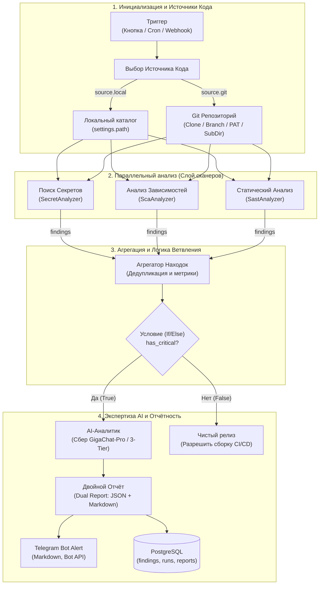

# 🛡️ uncflow — Архитектура и Процесс Проверки Безопасности

Документ описывает полный цикл работы платформы **uncflow**: от срабатывания триггера и клонирования репозитория до многослойного параллельного статического анализа, работы AI-эксперта Сбер GigaChat-Pro, формирования отчетов по строгой спецификации и отправки оповещений.

---

## 1. Архитектурная схема пайплайна



---

## 2. Пошаговый цикл выполнения

### Этап 1. Триггеры и получение исходного кода

1. **Триггеры запуска**:
   * **`trigger.manual`** — интерактивный запуск пользователем по кнопке «Запустить» в интерфейсе или вызов REST API `POST /api/workflow/execute`.
   * **`trigger.schedule`** — периодический запуск по Cron-выражению (например, `0 14 * * *`).
   * **`trigger.webhook`** — интеграция с CI/CD (GitHub Actions, GitLab CI) на коммиты или Pull Request'ы.

2. **Загрузка кодовой базы**:
   * **`source.local`**:
     * Разрешает относительные и абсолютные пути из `settings.path`.
     * Проверяет физическое существование каталога на диске.
     * Возвращает `{ codePath: "/path/to/project" }`.
   * **`source.git`**:
     * Принимает `repoUrl`, целевую ветку `branch`, поддиректорию `subDir`, глубину истории `depth` и токен доступа `token` (Personal Access Token).
     * Выполняет клонирование или `git fetch / git pull` в каталог кэша `.cache/repos/<slug>`.
     * Для тестового хакатонного репозитория `TBagirov/training` задействует автоматический fast-path в локальную директорию.
     * Возвращает `{ codePath: "<путь_к_проекту>", repoUrl, branch }`.

---

### Этап 2. Оркестрация в DAG-движке (WorkflowEngine)

1. **Топологическая сортировка (`DagManager`)**:
   * Граф узлов и ребер валидируется на отсутствие циклических зависимостей.
   * Узлы группируются в параллельные слои исполнения (слой источников ➔ слой сканеров ➔ слой агрегатора ➔ слой логики ➔ слой отчетов).
2. **Параллельное исполнение**:
   * Все узлы одного слоя запускаются одновременно через `Promise.all()`.
3. **Маршрутизация данных по портам**:
   * Данные передаются строго из портов-источников (`outputs`) в связанные порты-приёмники (`inputs`).
4. **Live Streaming (SSE)**:
   * Все изменения статусов (`idle` ➔ `running` ➔ `completed`) в реальном времени транслируются через Server-Sent Events (`/api/events`), анимируя световые импульсы по связям на холсте интерфейса.

---

### Этап 3. Специализированный статический анализ (3 сканера)

#### 1. Поиск Секретов (`SecretAnalyzer`)
* **Область сканирования**: файлы Kotlin (`.kt`), Java (`.java`), YAML-конфигурации (`.yml`, `.yaml`), Java Properties (`.properties`).
* **Правила обнаружения**:
  1. `password` — захардкоженные пароли в коде и конфигурациях (`spring.datasource.password=...`, `password: "..."`).
  2. `api-key` — приватные ключи и токены с высокой энтропией Шеннона ($> 3.3$).
  3. `configuration-token` — открытые токены авторизации (Bearer-токены в YAML/properties).
  4. `secret-fallback` — скрытые резервные пароли и токены в выражениях `System.getenv("...") ?: "fallback_secret"`.
  5. `recoverable-token` — токены, собираемые конкатенацией строковых фрагментов (`part1 + part2`).
* **Фильтрация ложных срабатываний**: игнорируются ссылки на переменные окружения `${DB_PASSWORD}`, шаблонные инструкции в `README.md` и валидные плейсхолдеры.

#### 2. Анализ Зависимостей (`ScaAnalyzer`)
* **Область сканирования**: файлы `build.gradle.kts`, `gradle.properties`, `gradle.lockfile`.
* **Правила обнаружения**:
  1. Раскрытие переменных версий Kotlin DSL (`val libVersion = "1.2.3"`, `$libVersion`).
  2. Разрешение транзитивных версий через lock-файлы.
  3. Сопоставление с базой уязвимостей PostgreSQL и `vulnerabilities.json`:
     - Строгое вычисление диапазонов версий SemVer (`<`, `<=`, `>`, `>=`).
     - Сопоставление по `group:artifact` и присвоение идентификаторов CVE / GHSA.

#### 3. Статический Анализ Кода (`SastAnalyzer`)
* **Область сканирования**: дерево исходного кода Kotlin/Spring Boot.
* **Правила обнаружения**:
  1. **SQL / HQL Injection**:
     - Поиск непараметризованных запросов в Spring `JdbcTemplate` (`query`, `queryForList`, `execute`).
     - Поиск Hibernate / JPA `EntityManager` (`createQuery`, `createNativeQuery`, `createNamedQuery`).
     - Контекстный трекинг переменных: связывание промежуточных SQL-строк с интерполяцией (`val sql = "SELECT ... $id"`) с последующим вызовом метода создания запроса.
     - Безопасные параметризованные запросы с позиционными плейсхолдерами `?` и именованными параметрами `:param` строго исключаются из находок.
  2. **TLS Verification Bypass**:
     - Ослабление проверки сертификатов (`hostnameVerifier = HostnameVerifier { _, _ -> true }`).
  3. **Credentialed CORS**:
     - Опасная конфигурация одновременного разрешения учетных данных `allowCredentials = true` с подстановочным знаком происхождения `allowedOrigins = "*"`.
  4. **Route Authorization**:
     - Контроллеры и пути Spring Security, доступные без аутентификации (`permitAll()` на административных или пользовательских эндпоинтах).
  5. **IDOR / Object Authorization**:
     - Доступ к объектам по идентификатору из URL/параметра без верификации прав текущего пользователя через `SecurityContext` / `Authentication`.

---

### Этап 4. Агрегация и Логика Ветвления

1. **Агрегатор (`scanner.aggregator`)**:
   * Объединяет входные потоки от всех подключенных сканеров.
   * Дедуплицирует записи по составному ключу `category + path + line + class/advisoryId`.
   * Формирует агрегированные счетчики: общее количество, `CRITICAL`, `HIGH`, `MEDIUM`, `LOW`.
2. **Логический узел (`logic.condition`)**:
   * Проверяет условие ветвления:
     - `has_critical`: наличие уязвимостей уровней `CRITICAL` или `HIGH`.
     - `has_any`: обнаружение любых проблем ($> 0$).
     - `is_clean`: проект полностью чист ($= 0$).
     - `threshold_count`: количество проблем превышает заданный порог.
   * Направляет поток:
     - **True**: переход к генерации отчёта, детальному анализу AI и отправке алертов.
     - **False**: сценарий завершается с отметкой допуска сборки к релизу.

---

### Этап 5. Экспертиза AI и Сбер GigaChat-Pro

Использует 3-уровневый каскад (**GigaChat-Pro** ➔ **Локальный экспертный движок** ➔ **Стандартный маппер**):
* **Категоризация стандартов**: сопоставляет каждую уязвимость с каталогом **CWE** (CWE-89, CWE-798, CWE-295 и т.д.) и **OWASP Top 10** (A01:2021, A03:2021, A07:2021).
* **Оценка рисков**: расчет метрики **CVSS v3.1** и описание вектора атаки для злоумышленника.
* **Рекомендации и Патчи**: генерация готового безопасного фрагмента кода на Kotlin.
* **Резюме CISO (Executive Summary)**:
  - Вердикт допуска релиза (🚨 *БЛОКИРОВАН* / ✅ *ДОПУЩЕН*).
  - Приоритетные шаги устранения угроз на первые 24 часа.

---

### Этап 6. Экспорт отчётов, Telegram и База Данных

1. **Двойной отчёт (`report.dual`)**:
   * **`reports/submission-report.json`**: строгий машиночитаемый JSON согласно официальной спецификации конкурса:
     ```json
     {
       "findings": [
         {
           "category": "SAST",
           "path": "src/main/kotlin/...",
           "class": "sql-injection",
           "line": 16,
           "severity": "CRITICAL",
           "remediation": "..."
         }
       ]
     }
     ```
   * **`reports/audit-report.md`**: подробный документ для разработчиков и службы ИБ с таблицами проблем, метриками и патчами.

2. **Оповещения в Telegram (`notify.telegram`)**:
   * Прямой вызов к Telegram Bot API (`POST https://api.telegram.org/bot<token>/sendMessage`).
   * Форматированное Markdown-сообщение с цветовой индикацией критичностей (🔴, 🟠, 🟡, 🔵), итоговым вердиктом и списком ключевых уязвимостей.
   * Настройка `onlyOnCritical`: отправка только при наличии критических угроз.

3. **Персистентность в PostgreSQL**:
   * `workflow_runs`: фиксация каждого прогона (время старта/окончания, длительность, счётчики уязвимостей).
   * `findings`: структурированное сохранение каждой отдельной находки для ретроспективного анализа.
   * `reports`: сохранение сгенерированных JSON и Markdown отчётов.
   * `workflow_templates`: сохранение персональных и общедоступных шаблонов с поддержкой профилей пользователей (`user_id`, `is_public`).

---

## 3. Сводная таблица параметров нод

| Нода | Категория | Основные входные параметры (Settings) | Что возвращает на выходе (Outputs) |
| :--- | :--- | :--- | :--- |
| **`trigger.manual`** | Triggers | `label` (текст) | `{ start: true }` |
| **`trigger.schedule`**| Triggers | `cron` (строка), `enabled` (boolean) | `{ start: true, cron }` |
| **`trigger.webhook`** | Triggers | `secretToken` (пароль) | `{ start: true, codePath }` |
| **`source.local`** | Sources | `path` (путь к проекту) | `{ codePath: string }` |
| **`source.git`** | Sources | `repoUrl`, `branch`, `subDir`, `token`, `depth` | `{ codePath: string, repoUrl, branch }` |
| **`scanner.secrets`** | Scanners | `entropyThreshold` (число), `minSeverity` (select) | `{ findings: Finding[], count: number }` |
| **`scanner.sca`** | Scanners | `dbPath` (путь), `minSeverity` (select) | `{ findings: Finding[], count: number }` |
| **`scanner.sast`** | Scanners | `minSeverity` (select) | `{ findings: Finding[], count: number }` |
| **`scanner.aggregator`**| Scanners | `deduplicate` (boolean) | `{ allFindings: Finding[], counts: object }` |
| **`logic.condition`** | Logic | `rule` (has_critical/has_any/is_clean/threshold_count), `threshold` | `{ result: boolean, true: any, false: any }` |
| **`ai.explainer`** | AI | `provider` (gigachat/offline), `model`, `credentials`, `apiUrl` | `{ aiReport: object, cisoSummary: object }` |
| **`ai.gigachat`** | AI | `model` (GigaChat-Pro/Max), `credentials`, `scope` | `{ aiReport: object, cisoSummary: object }` |
| **`report.dual`** | Reports | `outputDir` (каталог сохранения) | `{ reportFiles: { jsonPath, mdPath } }` |
| **`notify.telegram`** | Notifications | `botToken` (пароль), `chatId`, `onlyOnCritical`, `detailed` | `{ sent: boolean, deliveredAt, messageId }` |
| **`notify.webhook`** | Notifications | `url`, `secretHeader` (пароль) | `{ sent: boolean, targetUrl }` |
| **`storage.postgres`**| Storage | `tableName`, `saveReport` (boolean) | `{ saved: boolean, count: number, runId }` |
